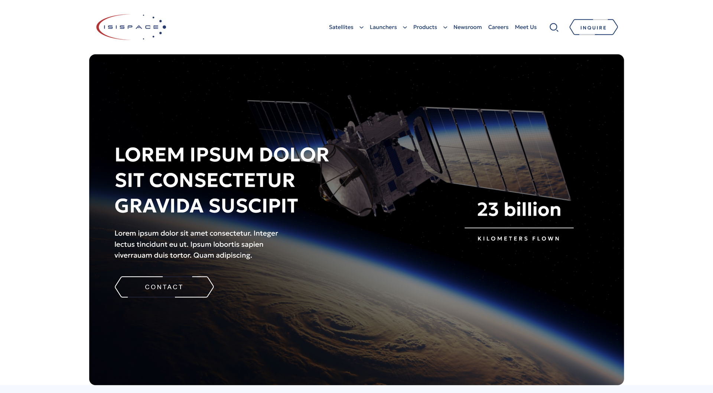

# ISISPACE — static theme (v1)

Static HTML/CSS/JS template for the ISISPACE website redesign. This is **version 1** of the front-end I built in **February 2025** while working at [Rekos Agency](https://rekos.agency/). The production site later evolved from this baseline.

This repo is the static layer only (the WordPress theme markup, styles, and scripts) so the UI can be reviewed without PHP, ACF, or a CMS. The shipped product was a custom WordPress theme converted from Figma into production-ready blocks.



[](https://www.milossturanovic.com/projects/isispace)
[](https://www.isispace.nl/)
[](https://www.figma.com/design/eJ47UL2O03tuGTYbSRXStG/ISISPACE-UI_UX?node-id=2446-3258&t=1fTJNpiYCXWVPZtH-1)
[](https://rekos.agency/)

---

## About the project

[ISISPACE](https://www.isispace.nl/) is a satellite systems company. The brief was a custom WordPress theme for their redesigned site: fast, customizable, and faithful to the Figma UI.

**My role:** front-end / WordPress theme development at Rekos Agency  
**Completed:** February 2025  
**Duration:** about 3 months  
**Client:** Rekos Agency / ISISPACE

Write-up on my site: [milossturanovic.com/projects/isispace](https://www.milossturanovic.com/projects/isispace)

---

## What this repo is

- Static pages that match the v1 theme templates
- Shared layout (nav, footer), section CSS, and jQuery / Bootstrap / Slick behaviour
- Placeholder copy and images from the design handoff

It is **not** the later live WordPress theme. Compare this markup with [isispace.nl](https://www.isispace.nl/) to see what changed after v1.

---

## Stack

HTML · CSS · JavaScript · Bootstrap 5 · jQuery · Slick · AOS

The WordPress build used PHP, ACF blocks, and the same front-end. Those files are not in this snapshot.

---

## Pages

| File | Template |
| --- | --- |
| `index.html` | Home |
| `about.html` | About / team |
| `products.html` | Products landing |
| `products-page.html` | Product detail |
| `product-slider.html` | Product slider |
| `project-filter.html` | Projects filter |
| `single-project.html` | Single project |
| `launch-equipment.html` | Launch equipment |
| `newsroom.html` | Newsroom |
| `article.html` | Article |
| `events.html` | Events |
| `single-event.html` | Single event |
| `media-centre.html` | Media centre |
| `contact-page.html` | Contact |
| `buy-page.html` | Buy / inquiry |
| `privacy-policy.html` | Privacy policy |
| `blocks.html` | Content blocks |
| `404.html` | 404 |

---

## Preview locally

All HTML files sit in the project root. The simplest way to view them:

1. Open the folder in your editor
2. Serve the folder as the site root, or open `index.html` in the browser
3. Click through the nav (Satellites, Launchers, Products, Newsroom, Careers, Meet Us, Inquire)

If styles look broken, do not open the file as `file://` from a nested path. Asset URLs are relative to this folder (`libs/`, `images/`, `fonts/`).

```bash
npx serve .
```

Then open the local URL and load `index.html`.

---

## Links

- Portfolio case study: [https://www.milossturanovic.com/projects/isispace](https://www.milossturanovic.com/projects/isispace)
- Figma: [ISISPACE UI/UX](https://www.figma.com/design/eJ47UL2O03tuGTYbSRXStG/ISISPACE-UI_UX?node-id=2446-3258&t=1fTJNpiYCXWVPZtH-1)
- Production site: [https://www.isispace.nl/](https://www.isispace.nl/)
- Agency: [https://rekos.agency/](https://rekos.agency/)
